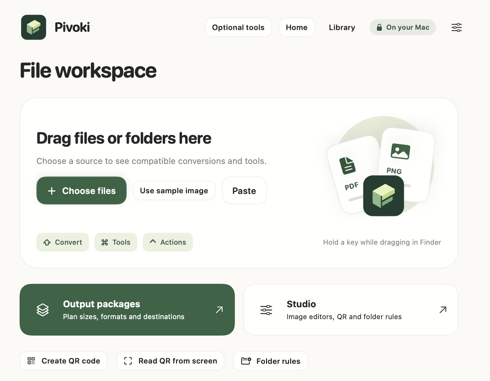
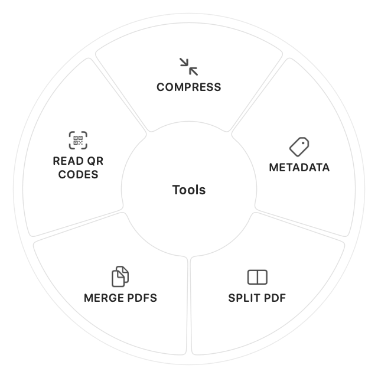
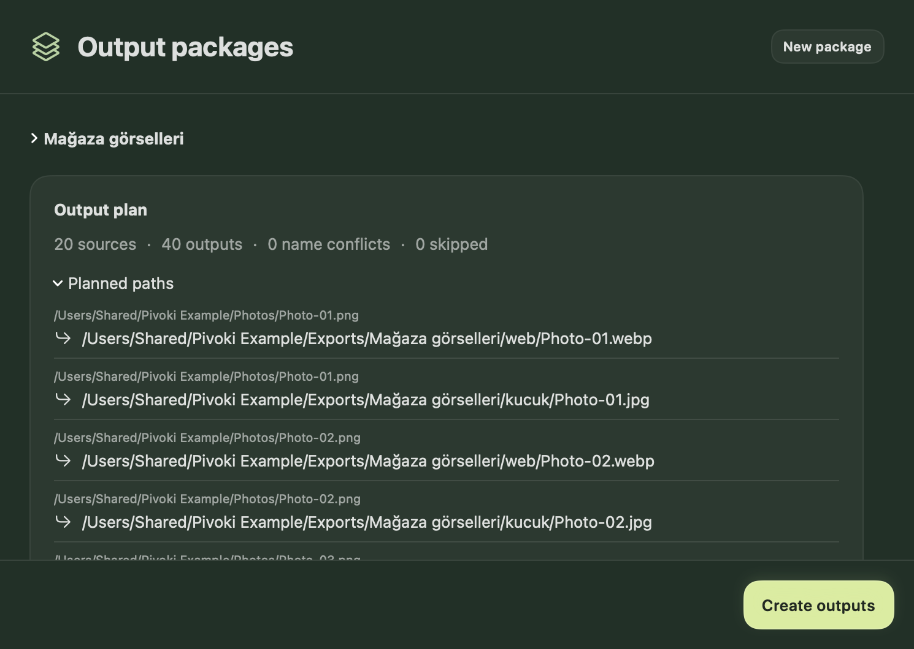

# Pivoki

Convert a file as you drag it in Finder, or turn a folder of photos into web images and thumbnails in one go. Pivoki processes your files on your Mac.

## Download and run on Mac

**[Download Pivoki 0.1.0 for Mac (ZIP, 46 MiB)](https://github.com/keremoktener/pivoki/releases/download/v0.1.0/Pivoki-0.1.0-macOS-Apple-Silicon.zip)**

Requires an **Apple silicon Mac** running **macOS 14 Sonoma or later**. You can check both under **Apple menu → About This Mac**.

1. Double-click the downloaded ZIP in Finder to extract **Pivoki.app**.
2. Drag **Pivoki.app** into **Applications**, then double-click it there.
3. This build is locally signed and unnotarized. If macOS says it cannot verify the developer and you trust the download, open **System Settings → Privacy & Security**, find the message for Pivoki, and click **Open Anyway**. Confirm when prompted. [Apple’s first-open guide](https://support.apple.com/en-us/102445)

Pivoki stays in the menu bar when you close its window. Click its icon and choose **Pivoki** to reopen the workspace. Starting at login is enabled by default after the first launch. You can turn it off in **Pivoki Settings → General → Launch at login**.

## Try your first conversion

On **Home**, click **Use sample image**, then **Convert** and choose **JPG**. Open **Library** to find the result. To use your own files, drop them onto the workspace or click **Choose files**.

<p align="center">
  
</p>

## Use the wheel in Finder

With Pivoki running, start dragging one or more files in Finder. While still dragging, press a shortcut to show the wheel under your pointer. Drop the files on the action you want. The available formats and tools depend on the files you picked.

| Default shortcut | Wheel | Try it |
| --- | --- | --- |
| **⇧ Shift** | Convert | Drag a PNG and drop it on **JPG**. |
| **⌘ Command** | Tools | Drag two PDFs and drop them on **Merge PDFs**. |
| **⌃ Control** | Actions | Drop files on **Float** to carry them between windows. Drag the paperclip to move the shelf, or drag the stack to drop all its files together. |

<p align="center">
  
</p>

## Export a folder in multiple sizes

Suppose you have 20 photos and want a web image and a thumbnail for each. The built-in **Mağaza görselleri** (“Store images”) package makes a WebP up to 1,600 px on its longest edge and a JPEG thumbnail up to 400 px. Smaller images keep their original dimensions.

1. On **Home**, open **Output packages** and select **Mağaza görselleri**.
2. Choose the photos or their folder, select an output folder, and click **Preview output plan**.
3. Check the filenames and destinations. Click **Create outputs** to write the files, then **Show output folder** to see them in Finder.

<p align="center">
  
</p>

Use **New package** to save your own combination of formats, sizes and subfolders for the next batch. For image editors, QR codes or folder rules, open **Studio** from Home. Some media and document tools require additional downloads. [Optional tools and requirements](macos/BUILD.md#optional-engines)

## Build from source

On macOS, install Xcode with Swift 6 and Python 3.11 or 3.12 with Tk. From the repository root, run this command to build and open the app. The first build downloads its dependencies.

```sh
./macos/build-from-source.sh && open dist/Pivoki.app
```

[macOS build guide and CLI](macos/BUILD.md) · [Windows build guide](windows/README.md) · [Linux installation guide](linux/README.md) · [GitHub releases](https://github.com/keremoktener/pivoki/releases)

## License and credits

Original Pivoki code, artwork and documentation are available for personal, noncommercial use. The license prohibits selling or sublicensing these materials. The native Mac and Windows apps build on Nashi’s SwiftUI/AppKit and WPF code. Those portions retain their MIT license, and other third-party components retain their own terms. [Pivoki license](LICENSE) · [Third-party notices](Resources/THIRD-PARTY-NOTICES.txt)
